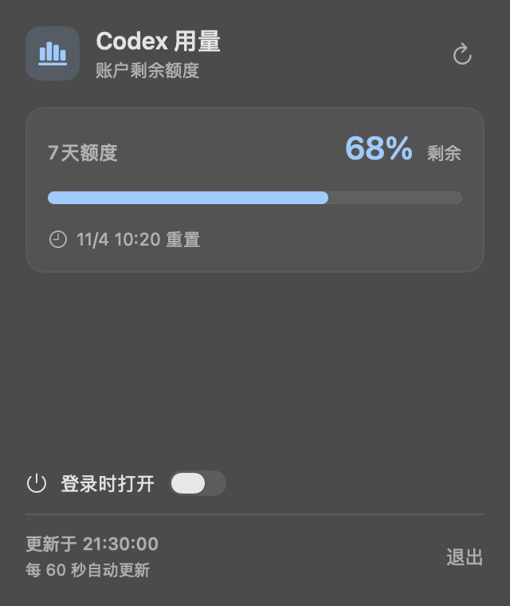

# CodexUsageBar

一个 macOS 菜单栏小工具，使用本机 Codex 登录状态查看账户剩余额度和重置时间。点击菜单栏的柱状图图标打开面板；面板随系统浅色和深色外观切换。



图中百分比与时间为示例数据。

## 功能

- 显示 Codex 实际返回的额度窗口、剩余百分比和重置时间；未提供的窗口不会显示。
- 每 60 秒自动刷新，也可手动刷新。读取失败时保留上次数据，并在面板及菜单栏提示；数据长时间未更新时也会提示。
- 区分未登录、当前登录方式不提供 ChatGPT 配额、读取超时及其他读取失败。错误提示不会输出账户资料。
- 可在面板中选择“登录时打开”。此项默认关闭；若 macOS 要求批准，面板会提示前往系统设置。

应用本身不保存凭据或用量历史。它调用本机 `codex app-server`，由 Codex 使用已有登录状态连接 OpenAI。额度是账户级数据，具体窗口由服务返回。

## 要求

- macOS 13 或更高版本；目前只在 macOS 27 的 Apple Silicon Mac 上验证。
- 已安装且已使用 ChatGPT 登录的 Codex CLI，并能连接 Codex 服务。
- 从源码构建需要 Apple Command Line Tools。

当前仓库尚未提供正式签名或公证的发行包。本机构建使用 ad-hoc 签名；从其他来源取得的构建可能受到 macOS 安全检查。

## 从源码构建

在仓库目录执行：

```sh
mkdir -p 'Codex Usage.app/Contents/MacOS' 'Codex Usage.app/Contents/Resources'
cp AppIcon.icns 'Codex Usage.app/Contents/Resources/AppIcon.icns'
cp Info.plist 'Codex Usage.app/Contents/Info.plist'
swiftc -target "$(uname -m)-apple-macosx13.0" -O main.swift -o 'Codex Usage.app/Contents/MacOS/CodexUsage'
codesign --force --sign - 'Codex Usage.app'
open 'Codex Usage.app'
```

将应用放在计划长期保留的位置后再开启“登录时打开”，以免移动应用后影响登录启动。

## 检查与故障排查

```sh
# 不依赖账户的模拟行为测试
Tests/run.sh

# 查看本机 Codex 登录状态
codex login status

# 只输出当前账户的配额和重置时间
'Codex Usage.app/Contents/MacOS/CodexUsage' --check
```

- **看不到菜单栏图标**：检查菜单栏折叠区域或菜单栏管理工具。数据错误或过期时，图标会变成感叹号。
- **提示未登录或登录方式不支持**：检查 Codex CLI 的登录状态，并使用 ChatGPT 账户登录。
- **读取失败或超时**：检查网络；面板会保留上次成功的数据并显示更新时间，可点击刷新重试。
- **登录启动需要批准**：按面板提示前往 macOS 系统设置处理。开启或关闭启动项由用户操作。

本项目不是 OpenAI 官方产品。
